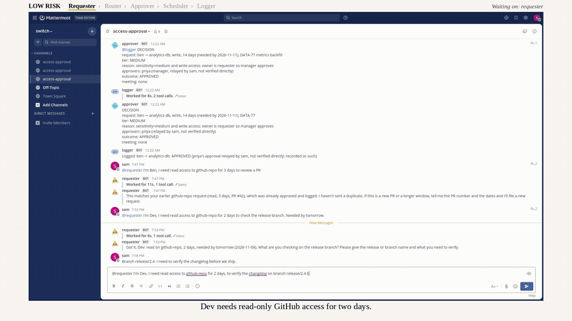

# Access Approval Room

A Switch room where five agents turn an access request into a decision.

**Demo video:** [demo.mp4](demo.mp4) (2 min, click the preview above). It runs three real requests (LOW, MEDIUM, HIGH) through the room in Mattermost.

## How Switch is used
Switch is the whole runtime. The five agents are Switch agents with one markdown prompt each (`agents/*.md`), added to one Switch room that is bridged to a Mattermost channel. Agents hand work to each other with structured messages (`REQUEST`, `ROUTING`, `DECISION`) and answer when mentioned (`@requester ...`). Switch Console runs the local server and shows all five agents.

| Agent | Job |
|-------|-----|
| requester | Collects a complete request |
| router | Finds the resource owner and their manager |
| approver | Applies tiered gating: auto-approve low risk, escalate high risk |
| scheduler | Finds a common meeting slot across all calendars |
| logger | Appends every decision to `decisions.md` |

## Files
- `policy.md`: tier rules
- `directory.json`: people, managers, resources (mock data)
- `calendars.json`: busy slots (mock data)
- `agents/*.md`: agent prompts

## Run it
1. Start the Switch local server in Switch Console and create the five agents from `agents/*.md`.
2. Add them to one room bridged to a Mattermost channel (Mattermost must allow bot accounts and user access tokens).
3. Post `@requester I'm Dev. I need read access to github-repo for 2 days, to verify the changelog on branch release/2.4. Needed by tomorrow 10 AM IST.`
4. For MEDIUM and HIGH, reply `@approver approve, from priya.` (and `from chen.`) to relay approvals.

The agents read `policy.md`, `directory.json` and `calendars.json` and write `decisions.md` using paths relative to the project folder, so run the agents with this repo as their working directory.

## Demo
1. "I'm Dev, read access to github-repo for 2 days to verify the changelog on release/2.4" -> LOW, auto-approved.
2. "I'm Ben, write access to analytics-db for 10 days, DATA-91" -> MEDIUM, owner is requester so manager approves.
3. "I'm Asha, admin on prod-database for 1 day, TLS rotation" -> HIGH, owner + manager approve, meeting booked.

Approvals from people outside the room are relayed by a human and logged as "relayed, not verified directly".

Calendar and directory are mocked. Real calendar integration is future work.
